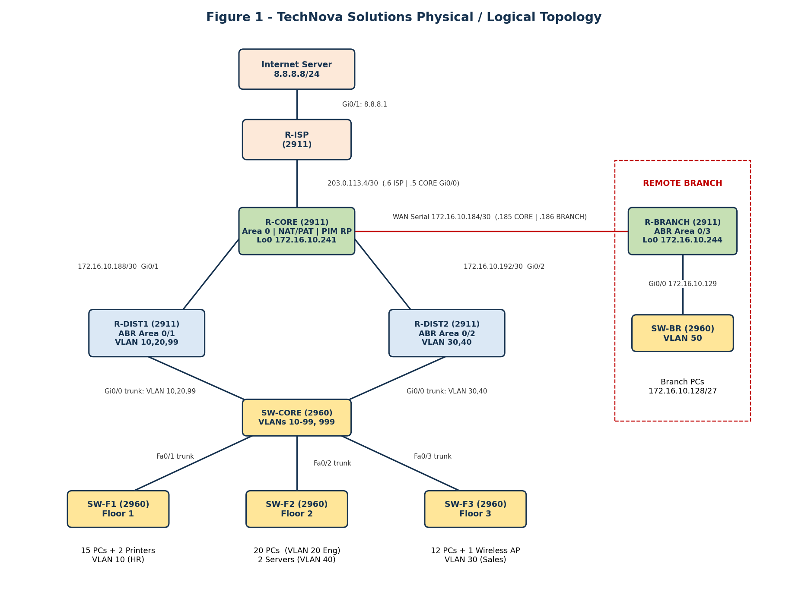
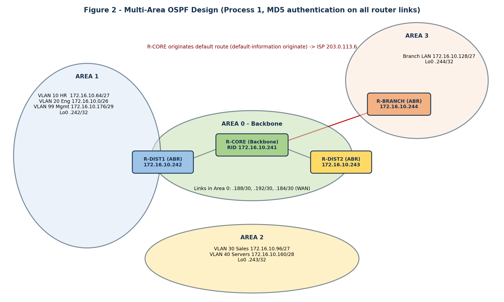
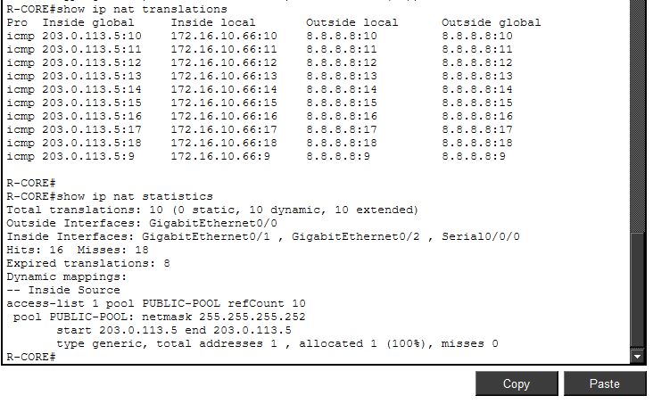
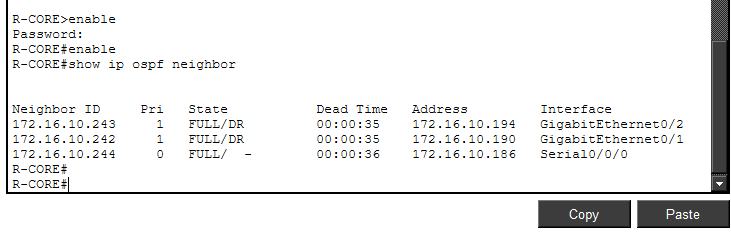
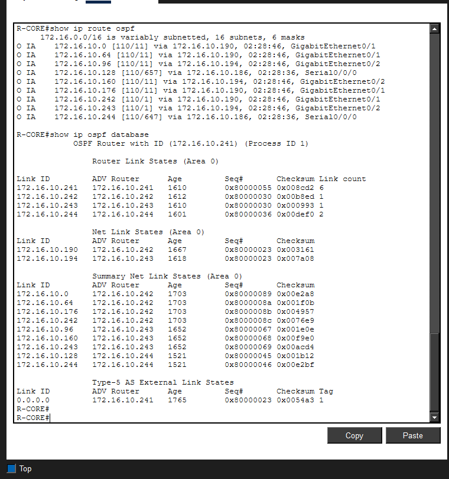
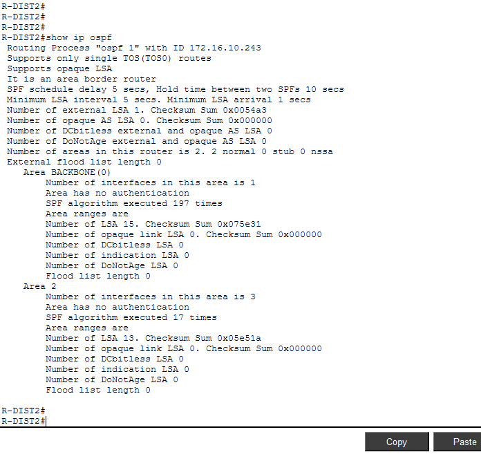
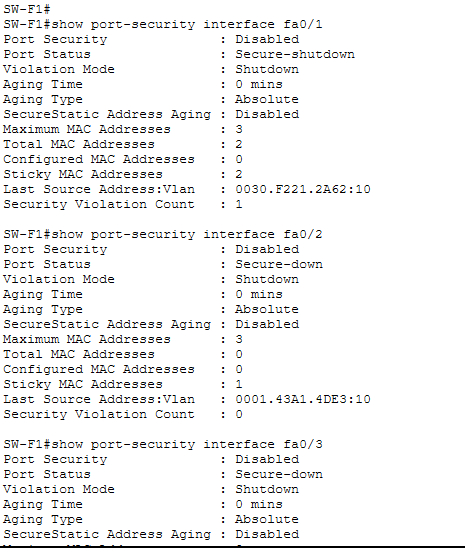
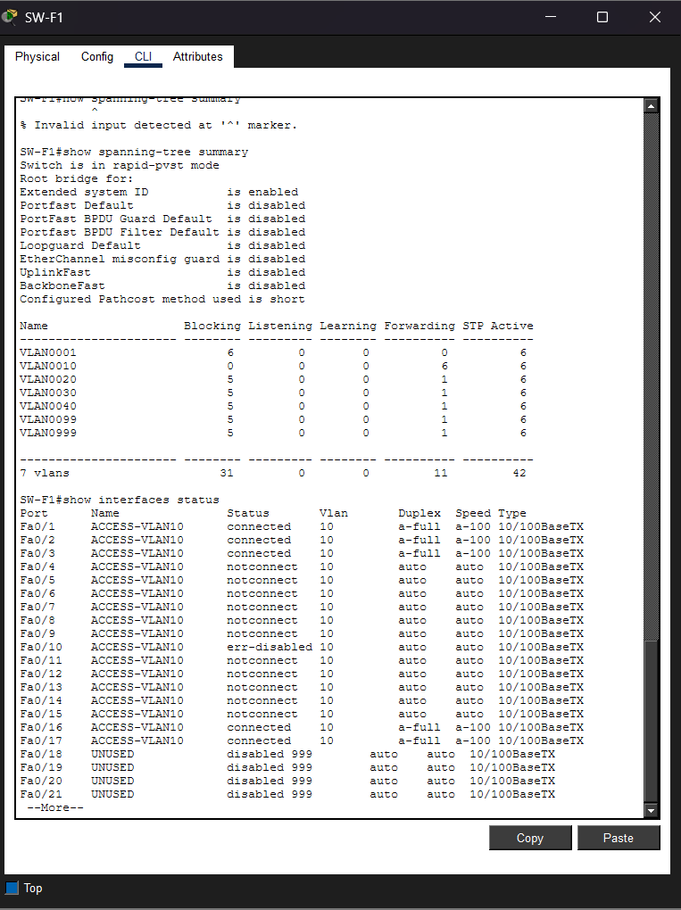

# TechNova Solutions - Enterprise Network Design & Implementation

A complete enterprise network for a fictional three-floor company with a remote branch, designed and built in **Cisco Packet Tracer**. It covers IPv4/IPv6 addressing, NAT, VLANs and inter-VLAN routing, Layer 2 security, multi-area OSPF with authentication, and a multicast design.

> University group project - IE3140 Advanced Network Engineering (Year 3, Semester 1, 2026).



## Highlights

| Area | What was built |
|---|---|
| **IPv4 design** | VLSM on `172.16.10.0/24`: 196 of 256 addresses used, 44 free for growth |
| **IPv6** | `2001:DB8:ACAD::/48`, one /64 per VLAN (subnet ID mirrors the VLAN), dual-stack on all router interfaces |
| **NAT** | PAT (pool + overload) sharing one public IP, `203.0.113.5`, for all inside hosts |
| **Switching** | 6 VLANs, 802.1Q trunks with pruning, native VLAN 999, Rapid-PVST |
| **Inter-VLAN routing** | Router-on-a-stick on two distribution routers, router-based DHCP |
| **Layer 2 security** | Port security (sticky, max 2, shutdown), BPDU Guard, DHCP snooping |
| **Routing** | Single-area OSPFv2, then 4-area OSPF (3 ABRs), MD5 authentication on every router link, default route origination |
| **Multicast** | PIM sparse mode design with static RP, IGMP v2 and IGMP snooping (see limitations) |
| **Troubleshooting** | OSPF MD5 key mismatch diagnosed with `show` and `debug` commands, then fixed |

## Addressing plan

| Segment | VLAN | Network | Gateway |
|---|---|---|---|
| Engineering | 20 | 172.16.10.0/26 | .1 |
| HR | 10 | 172.16.10.64/27 | .65 |
| Sales | 30 | 172.16.10.96/27 | .97 |
| Branch LAN | 50 | 172.16.10.128/27 | .129 |
| Server Farm | 40 | 172.16.10.160/28 | .161 |
| Management | 99 | 172.16.10.176/29 | .177 |
| WAN (R-CORE to R-BRANCH) | - | 172.16.10.184/30 | .185 / .186 |
| R-CORE to R-DIST1 / R-DIST2 | - | 172.16.10.188/30, .192/30 | - |

Loopbacks (router IDs, PIM RP): `172.16.10.241` to `.244`.

## OSPF design



- **Area 0:** R-CORE (backbone, NAT, default route)
- **Area 1:** Floors 1-2 (R-DIST1, ABR)
- **Area 2:** Floor 3 and servers (R-DIST2, ABR)
- **Area 3:** Branch (R-BRANCH, ABR)

## Repository structure

```
configs/
  01_phase1_single_area/            device configs, single-area OSPF
  02_final_multi_area_multicast/    final device configs (multi-area + multicast block)
  03_phase2_multi_area_conversion.txt
  04_multicast_commands.txt
  05_ospf_troubleshooting.txt
  06_verification_commands.txt
docs/images/                        topology, diagrams and verification screenshots
packet-tracer/
  technova-phase3-single-area.pkt   single-area OSPF checkpoint
  technova-phase4-multi-area.pkt    multi-area OSPF checkpoint
  technova-network-final.pkt        final network (open this one first)
```

## How to reproduce

Quickest way: open `packet-tracer/technova-network-final.pkt` in Cisco Packet Tracer 8.x. To rebuild from scratch:

1. In Packet Tracer 8.x, place five 2911 routers (add a `HWIC-2T` to R-CORE and R-BRANCH) and five 2960-24TT switches. Name them exactly as the config files.
2. Cable them as in the topology diagram (serial DCE cable for the WAN).
3. Replace the placeholders `<CHANGE_ME>` (console, VTY and enable passwords) and `<OSPF_MD5_KEY>` (same key on all router links) in the configs.
4. Paste `01_phase1_single_area` into each device CLI (routers first, then switches), wait for STP and OSPF to converge, and verify with `06_verification_commands.txt`.
5. Apply `03_phase2_multi_area_conversion.txt` for the multi-area design.

## Verification evidence

| | |
|---|---|
|  |  |
| PAT translations to 203.0.113.5 | OSPF adjacencies FULL on R-CORE |
|  |  |
| Inter-area routes and LSDB | R-DIST2 as area border router |
|  |  |
| Port-security violation | BPDU Guard err-disable |

More screenshots (VLANs/trunks, DHCP snooping, IPv6 dual-stack, troubleshooting) are in `docs/images/`.

## Known limitations

- **Multicast:** the Cisco 2911 image in the Packet Tracer version used rejected `ip multicast-routing`, `ip pim` and `ip igmp`, so the multicast stream could not be demonstrated. The design and command set are included, and RP reachability through OSPF was verified.
- Router-on-a-stick shares one link per router for inter-VLAN traffic. A Layer 3 core with HSRP/EtherChannel would add redundancy.
- Passwords and keys in the `configs/` text files are placeholders; the `.pkt` files are lab builds with their own lab credentials.

## Skills demonstrated

VLSM and IPv6 planning, NAT/PAT, VLANs and 802.1Q trunking, inter-VLAN routing, Layer 2 hardening, multi-area OSPF and authentication, DHCP, troubleshooting with `show` and `debug`, network documentation.

## Team

Dilnethu R G H, Rathnayaka R.M.C.D, Senarathne B.A.T, Kirushan R

## Academic note

This repository documents coursework. If you are a student, use it for reference only and follow your own institution's academic integrity rules.
